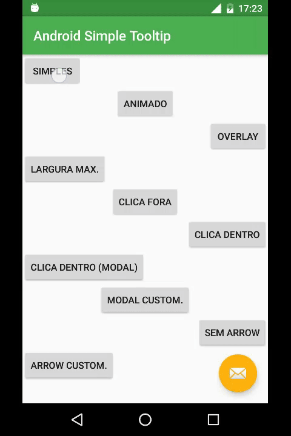

<p align="center">
  
  <br>
  <sub>A simple library based on PopupWindow to create customizable tooltips on Android.</sub>
</p>

<p align="center">
  <b>Android Simple Tooltip</b> is a lightweight and easy-to-use library based on <a href="https://developer.android.com/reference/android/widget/PopupWindow">PopupWindow</a> to create flexible, animated tooltips, guided tours, and onboarding hints on Android with a clean, fluent Builder API.
</p>

<p align="center">
  <a href="LICENSE"></a>
  <a href="https://jitpack.io/#douglasjunior/android-simple-tooltip"></a>
  <a href="https://jitpack.io/#douglasjunior/android-simple-tooltip"></a>
  
  
  <a href="https://android-arsenal.com/details/1/3578"></a>
  <a href="https://github.com/douglasjunior/android-simple-tooltip/pulls"></a>
</p>

<p align="center">
  <a href="README.pt.md">🇧🇷 <b>Documentação em Português</b></a>
</p>

<p align="center">
  <a href="#-quick-start"><b>Quick Start</b></a> ·
  <a href="#-why-android-simple-tooltip">Why</a> ·
  <a href="#-demo">Demo</a> ·
  <a href="#-installation">Installation</a> ·
  <a href="#-usage--examples">Usage</a> ·
  <a href="#-customization--resources">Resources</a> ·
  <a href="#-api-reference">API Reference</a> ·
  <a href="#platform-notes--known-issues">Known Issues</a> ·
  <a href="#-contributing">Contributing</a>
</p>

---

## 🚀 Quick Start

Add JitPack repository to your root `build.gradle`:

```groovy
allprojects {
    repositories {
        google()
        mavenCentral()
        maven { url 'https://jitpack.io' }
    }
}
```

Add the dependency to your module `app/build.gradle`:

```groovy
dependencies {
    implementation 'com.github.douglasjunior:android-simple-tooltip:1.1.0'
}
```

Show a tooltip anchored to any `View` with a single chained call:

```java
View yourView = findViewById(R.id.your_view);

new SimpleTooltip.Builder(this)
    .anchorView(yourView)
    .text("Welcome to the new feature!")
    .gravity(Gravity.BOTTOM)
    .animated(true)
    .transparentOverlay(false)
    .build()
    .show();
```

---

## 💡 Why Android Simple Tooltip?

- 🎯 **Fluent Builder Pattern.** Configure anchors, gravities, colors, offsets, and callbacks in a single chained statement.
- ⚡ **Lightweight & Independent.** Built on standard Android `PopupWindow`, requiring zero heavy third-party dependencies.
- 🎬 **Smooth Floating Animations.** Configurable subtle floating motion with custom duration and translation distance.
- 🔍 **Spotlight Backdrop Overlays.** Focus user attention with dimmed backgrounds featuring oval or rounded-rectangular spotlight cutouts.
- 🎛️ **Granular Dismiss Control.** Dismiss on touch inside, touch outside, or block background interactions in modal mode.
- 📐 **Customizable Shapes & Arrows.** Control arrow dimensions, direction, colors, or substitute your own custom drawable.
- 🧩 **Inflatable Custom Layouts.** Inflate complex XML layouts with custom buttons, inputs, and interactive views inside the tooltip.
- 🎨 **Deep Resource Theming.** Override styling globally via XML dimensions, colors, and styles without touching Java code.

---

## 📸 Demo

<p align="center">
  
</p>

Explore the complete sample app in the [`sample`](sample/src/main/java/io/github/douglasjunior/androidSimpleTooltip/sample/MainActivity.java) directory.

---

## 📦 Installation

### 1. Configure Repository

Add JitPack to your root `build.gradle` at the end of repositories:

```groovy
allprojects {
    repositories {
        google()
        mavenCentral()
        maven { url 'https://jitpack.io' }
    }
}
```

> [!NOTE]
> For projects using Gradle 7+ with `dependencyResolutionManagement` in `settings.gradle`:
> ```groovy
> dependencyResolutionManagement {
>     repositoriesMode.set(RepositoriesMode.FAIL_ON_PROJECT_REPOS)
>     repositories {
>         google()
>         mavenCentral()
>         maven { url 'https://jitpack.io' }
>     }
> }
> ```

### 2. Add Dependency

#### Stable Release

```groovy
dependencies {
    implementation 'com.github.douglasjunior:android-simple-tooltip:1.1.0'
}
```

#### Development Snapshot

To use the latest snapshot build from the `master` branch:

```groovy
dependencies {
    implementation('com.github.douglasjunior:android-simple-tooltip:master-SNAPSHOT') {
        changing = true // Gradle will check for updates every 24 hours
    }
}
```

---

## 💻 Usage & Examples

### 1. Basic Tooltip

Anchors to a target view and displays a simple message:

```java
View yourView = findViewById(R.id.your_view);

new SimpleTooltip.Builder(this)
    .anchorView(yourView)
    .text("Hello World!")
    .gravity(Gravity.END)
    .build()
    .show();
```

### 2. Animated Floating Tooltip

Enables a smooth bouncing translation animation:

```java
new SimpleTooltip.Builder(this)
    .anchorView(yourView)
    .text(R.string.tip_text)
    .gravity(Gravity.TOP)
    .animated(true)
    .animationDuration(1000)
    .animationPadding(SimpleTooltipUtils.pxFromDp(6))
    .build()
    .show();
```

### 3. Spotlight Backdrop Overlay

Darkens the surrounding screen while highlighting the anchor view with an oval or rounded-rectangular spotlight:

```java
new SimpleTooltip.Builder(this)
    .anchorView(yourView)
    .text("Focus attention on this element")
    .gravity(Gravity.START)
    .animated(true)
    .transparentOverlay(false)
    .highlightShape(OverlayView.HIGHLIGHT_SHAPE_RECTANGULAR_ROUNDED)
    .cornerRadius(20)
    .overlayOffset(0)
    .overlayWindowBackgroundColor(Color.BLACK)
    .build()
    .show();
```

### 4. Modal Mode & Dismissal Rules

Prevent users from interacting with the background while the tooltip is visible:

```java
new SimpleTooltip.Builder(this)
    .anchorView(yourView)
    .text("Modal tooltip: tap inside to dismiss")
    .gravity(Gravity.BOTTOM)
    .modal(true)
    .dismissOnInsideTouch(true)
    .dismissOnOutsideTouch(false)
    .build()
    .show();
```

### 5. Custom Inflatable XML Layout

Inflate a custom layout with custom views, action buttons, or text fields:

```java
final SimpleTooltip tooltip = new SimpleTooltip.Builder(this)
    .anchorView(yourView)
    .gravity(Gravity.TOP)
    .modal(true)
    .animated(true)
    .contentView(R.layout.tooltip_custom, R.id.tv_text)
    .focusable(true)
    .build();

// Access views inside the custom layout
Button btnNext = tooltip.findViewById(R.id.btn_next);
EditText edText = tooltip.findViewById(R.id.ed_text);

btnNext.setOnClickListener(v -> {
    tooltip.dismiss();
    // Do something with edText.getText()
});

tooltip.show();
```

### 6. Custom Arrow Direction & Icon

Customize or remove the indicator arrow:

```java
// Without arrow
new SimpleTooltip.Builder(this)
    .anchorView(yourView)
    .text("No arrow")
    .gravity(Gravity.CENTER)
    .showArrow(false)
    .build()
    .show();

// Custom arrow drawable and size
new SimpleTooltip.Builder(this)
    .anchorView(yourView)
    .text("Custom arrow")
    .gravity(Gravity.END)
    .arrowDrawable(R.drawable.ic_custom_arrow)
    .arrowWidth(SimpleTooltipUtils.pxFromDp(32))
    .arrowHeight(SimpleTooltipUtils.pxFromDp(32))
    .build()
    .show();
```

### 7. Inside Dialogs or DialogFragments

When showing tooltips inside a dialog, set `overlayMatchParent(false)` so the overlay respects the dialog's bounds:

```java
new SimpleTooltip.Builder(activity)
    .anchorView(btnInDialog)
    .text("Tip inside a Dialog")
    .gravity(Gravity.BOTTOM)
    .animated(true)
    .transparentOverlay(false)
    .overlayMatchParent(false)
    .build()
    .show();
```

---

## 🎨 Customization & Resources

You can override default styling globally across your app by defining these resources in your project's `res/values/`:

### Colors (`res/values/colors.xml`)

```xml
<resources>
    <!-- Tooltip bubble background color -->
    <color name="simpletooltip_background">@color/colorAccent</color>
    <!-- Tooltip default text color -->
    <color name="simpletooltip_text">@android:color/primary_text_light</color>
    <!-- Indicator arrow color -->
    <color name="simpletooltip_arrow">@color/colorAccent</color>
</resources>
```

### Dimensions (`res/values/dimens.xml`)

```xml
<resources>
    <dimen name="simpletooltip_overlay_offset">10dp</dimen>
    <dimen name="simpletooltip_margin">10dp</dimen>
    <dimen name="simpletooltip_padding">8dp</dimen>
    <dimen name="simpletooltip_arrow_width">30dp</dimen>
    <dimen name="simpletooltip_arrow_height">15dp</dimen>
    <dimen name="simpletooltip_animation_padding">4dp</dimen>
</resources>
```

### Integers (`res/values/integers.xml`)

```xml
<resources>
    <!-- Overlay backdrop darkness (0 to 255) -->
    <integer name="simpletooltip_overlay_alpha">120</integer>
    <!-- Duration of one animation cycle in milliseconds -->
    <integer name="simpletooltip_animation_duration">800</integer>
</resources>
```

### Styles (`res/values/styles.xml`)

Override `simpletooltip_default` in your app to customize default text appearance (the library style inherits `@android:style/TextAppearance.Medium`):

```xml
<resources>
    <style name="simpletooltip_default" parent="@android:style/TextAppearance.Medium">
        <!-- Example text appearance customizations -->
        <item name="android:textSize">14sp</item>
        <item name="android:textColor">@color/simpletooltip_text</item>
    </style>
</resources>
```

---

## 📚 API Reference

### `SimpleTooltip.Builder` Methods

| Method | Type / Parameter | Default | Description |
|---|---|---|---|
| `anchorView(View)` | `View` | _Required_ | Target view that the tooltip will point to. |
| `text(CharSequence)` | `CharSequence` | `""` | Text displayed in the tooltip. |
| `text(@StringRes int)` | `int` | | String resource ID for the tooltip text. |
| `gravity(int)` | `Gravity.TOP` / `BOTTOM` / `START` / `END` / `CENTER` | `Gravity.BOTTOM` | Side relative to the anchor where the tooltip appears. |
| `animated(boolean)` | `boolean` | `false` | Enables floating bounce animation (API 11+). |
| `animationDuration(long)` | `long` (ms) | `800` | Duration of each animation cycle. |
| `animationPadding(float)` | `float` / `@DimenRes int` | `4dp` | Travel distance of the animation in pixels. |
| `transparentOverlay(boolean)` | `boolean` | `true` | When `false`, darkens the screen backdrop with a spotlight. |
| `highlightShape(int)` | `OverlayView.HIGHLIGHT_SHAPE_*` | `OVAL` | Shape of the spotlight cutout (`OVAL`, `RECTANGULAR`, `RECTANGULAR_ROUNDED`). |
| `cornerRadius(float)` | `float` | `0` | Corner radius for rounded rectangular spotlight cutouts. |
| `overlayOffset(float)` | `float` (px) | `10dp` | Extra spacing between the anchor view and the spotlight cutout edge. |
| `overlayWindowBackgroundColor(int)` | `@ColorInt int` | `Color.BLACK` | Base color of the darkened backdrop overlay. |
| `overlayMatchParent(boolean)` | `boolean` | `true` | Set to `false` for dialogs/fragments so the overlay fits the dialog bounds. |
| `ignoreOverlay(boolean)` | `boolean` | `false` | Completely skips adding the overlay view to the root view hierarchy. |
| `modal(boolean)` | `boolean` | `false` | Blocks touch events on background views while the tooltip is open. |
| `dismissOnInsideTouch(boolean)` | `boolean` | `true` | Dismisses the tooltip when clicked inside its bubble. |
| `dismissOnOutsideTouch(boolean)` | `boolean` | `true` | Dismisses the tooltip when clicked outside its bubble. |
| `showArrow(boolean)` | `boolean` | `true` | Whether to display the indicator arrow. |
| `arrowDirection(int)` | `ArrowDrawable.*` | `AUTO` | Arrow direction (`AUTO`, `TOP`, `BOTTOM`, `LEFT`, `RIGHT`). |
| `arrowColor(int)` | `@ColorInt int` | Resource default | Tint color for the default arrow drawable. |
| `arrowDrawable(Drawable)` | `Drawable` / `@DrawableRes int` | Default shape | Custom drawable used as the indicator arrow. |
| `arrowWidth(float)` | `float` | `30dp` | Arrow base width in pixels. |
| `arrowHeight(float)` | `float` | `15dp` | Arrow height in pixels. |
| `contentView(View, int)` | `View, @IdRes int` | Default TextView | Custom view with an optional text view ID. |
| `contentView(@LayoutRes int, int)` | `int, @IdRes int` | | Layout resource to inflate with an optional text view ID. |
| `backgroundColor(int)` | `@ColorInt int` | Resource default | Background color of the default content bubble. |
| `textColor(int)` | `@ColorInt int` | Resource default | Text color for the default text view. |
| `maxWidth(float)` | `float` / `@DimenRes int` | `0` (unlimited) | Maximum width constraint for the tooltip bubble. |
| `margin(float)` | `float` / `@DimenRes int` | `10dp` | Margin between the anchor view and the tooltip bubble. |
| `padding(float)` | `float` / `@DimenRes int` | `8dp` | Internal padding within the tooltip bubble. |
| `focusable(boolean)` | `boolean` | Non-touch: `true` | Enables keyboard/D-pad navigation focus on non-touch devices. |
| `onDismissListener(listener)` | `OnDismissListener` | `null` | Callback invoked when the tooltip is dismissed. |
| `onShowListener(listener)` | `OnShowListener` | `null` | Callback invoked when the tooltip is displayed. |
| `build()` | `SimpleTooltip` | | Validates parameters and constructs the `SimpleTooltip` instance. |

### `SimpleTooltip` Instance Methods

| Method | Return Type | Description |
|---|---|---|
| `show()` | `void` | Displays the tooltip on screen anchored to the configured view. |
| `dismiss()` | `void` | Dismisses and cleans up the tooltip, overlay, and animations. |
| `isShowing()` | `boolean` | Returns `true` if the tooltip popup is currently visible. |
| `findViewById(@IdRes int id)` | `<T extends View> T` | Finds a view within the tooltip's inflated content layout. |

Check the [Javadoc documentation](https://jitpack.io/com/github/douglasjunior/android-simple-tooltip/master-SNAPSHOT/javadoc/) for full class references.

---

## Platform Notes & Known Issues

1. **`IllegalArgumentException: Could not lock surface`**
   - **Cause:** Occurs if a hosting `Activity` or `Dialog` is closed while the tooltip's floating animation is still running.
   - **Impact:** Does not crash or impact app stability. The library automatically catches and cleans up listeners upon dismissal.

2. **`android.view.WindowLeaked`**
   - **Cause:** Occurs if `tooltip.show()` is triggered after the parent `Activity` has already begun finishing or destroying. Refer to the [StackOverflow discussion](https://stackoverflow.com/questions/2850573/activity-has-leaked-window-that-was-originally-added).
   - **Prevention:** Always check `!isFinishing()` or dismiss the tooltip in your `onDestroy()` / `onStop()` lifecycle callback.

3. **`PopupWindow.setClippingEnabled` on Android 7.0+ (API 24+)**
   - **Cause:** Beginning in Android Nougat (API 24), the platform modified how `PopupWindow` clips contents against screen boundaries, which may crop popups near the edges.
   - **Workaround:** Adjust margin offsets or refer to [Issue #40](https://github.com/douglasjunior/android-simple-tooltip/issues/40) for specific boundary handling.

---

## 🤝 Contributing

Contributions, bug reports, and pull requests are warmly welcomed!

1. Read the sample project and inspect [`SimpleTooltip.java`](library/src/main/java/io/github/douglasjunior/androidSimpleTooltip/SimpleTooltip.java).
2. Fork the repository and create your topic branch (`git checkout -b feature/my-feature`).
3. Verify that Gradle build and checks pass:
   ```bash
   ./gradlew build connectedCheck
   ```
4. Open a pull request describing your improvements.

For questions and suggestions, please open an [Issue](https://github.com/douglasjunior/android-simple-tooltip/issues).

### Support the Author

If this library helped your project, consider supporting the maintainer:

<p align="left">
  <a href="https://www.patreon.com/douglasjunior"></a>
  &nbsp;
  <a href="https://paypal.me/douglasnassif"></a>
</p>

---

## ⭐ Star History

<p align="center">
  <a href="https://star-history.com/#douglasjunior/android-simple-tooltip&Date">
    <picture>
      <source media="(prefers-color-scheme: dark)" srcset="https://api.star-history.com/svg?repos=douglasjunior/android-simple-tooltip&type=Date&theme=dark" />
      
    </picture>
  </a>
</p>

---

## 📄 License

```text
The MIT License (MIT)

Copyright (c) 2016 Douglas Nassif Roma Junior
```

See the full [LICENSE](LICENSE) file for details.

---

## 🌐 Author & More Projects

<p align="center">
  <a href="https://douglasjunior.work">
    
  </a>
</p>

<p align="center">
  Discover more open-source libraries, creative animation engines, and developer tools at <a href="https://douglasjunior.work"><b>douglasjunior.work</b></a>.
</p>
